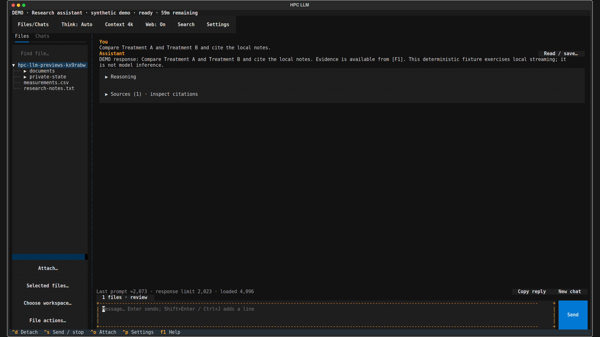
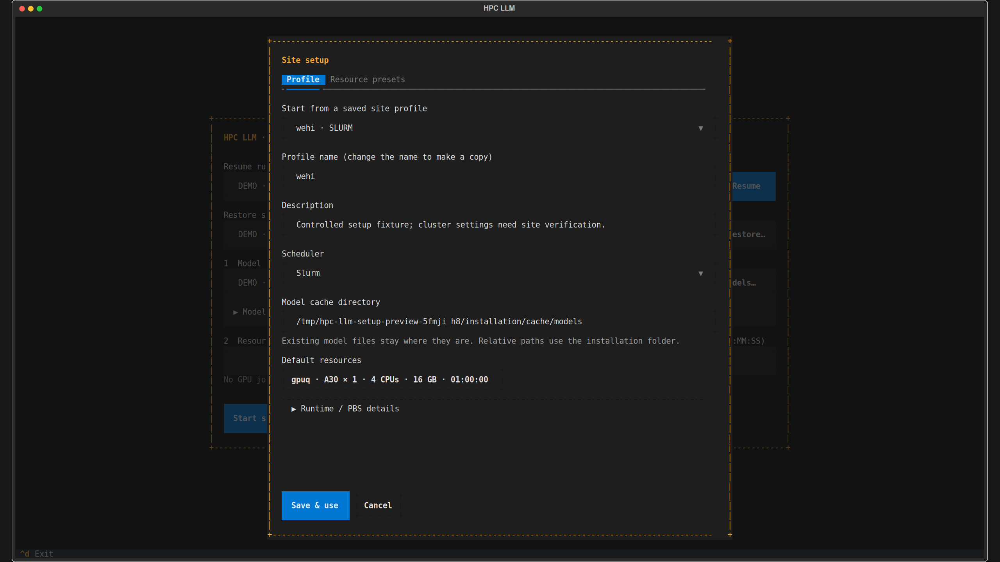
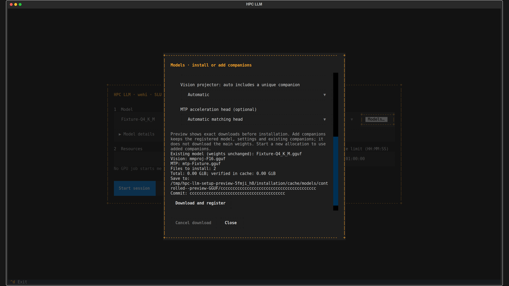
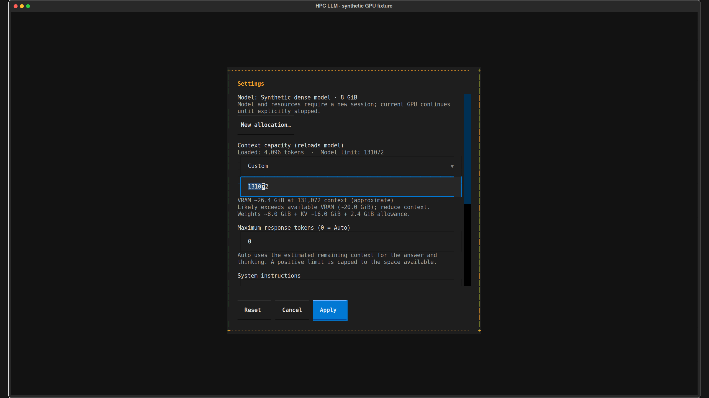
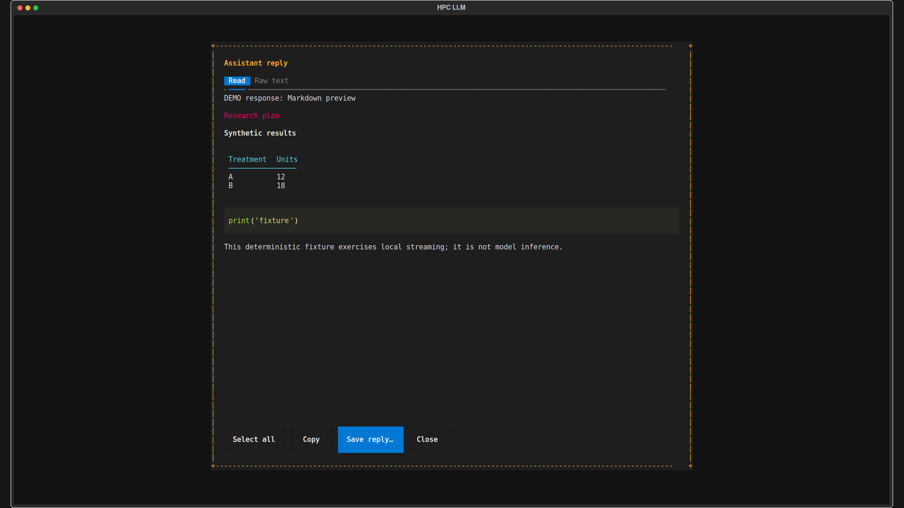

# HPC Llama

Run local GGUF models on a cluster GPU. Select/install models in the terminal launcher, then chat in the standard llama.cpp browser interface. The GPU batch job keeps running after you close the launcher.

The application uses llama.cpp in a persistent Slurm or PBS allocation. Slurm sessions use an attachable `srun` terminal. The batch job owns the model process.




## TUI launcher → native browser chat (recommended)

Run `./hpc-llm` on the login node. Keep the original terminal model installer and
resource picker, select **Browser · native llama.cpp**, and choose **Start session**.
The launcher submits one persistent GPU batch job, waits for readiness, prints
its compute-node Open OnDemand URL and private browser password, and exits.
You can then close the terminal. There is no login-node dashboard, separate CPU
job, or reverse SSH tunnel in this flow.

### Install this release

Finish or explicitly stop running sessions before updating their source files.
Upload the ZIP beside your existing `hpc-llm` directory, then:

```bash
unzip -o hpc-llm-web-release.zip
cd hpc-llm
bash install.sh
./hpc-llm launch --ood-url https://ondemand.hpc.wehi.edu.au
```

Use your own Open OnDemand origin on another cluster. The origin is remembered
after submission; future launches only need `./hpc-llm`.
`bash scripts/start-web.sh` is now an alias for this TUI launcher.
For a fresh installation choose a profile, e.g. `bash install.sh --profile wehi`.
Updating retains existing state, model registrations, caches and profiles.

The TUI keeps model downloads, exact-path model/projector/MTP registration,
resource presets and time limits. Context and MTP are configurable before launch.
Browser mode uses the native llama.cpp chat settings after startup. The native UI
has its own conversation storage and file-upload capabilities; the old TUI's
cluster file tools, web search and saved conversations do not transfer into it.
Export important native chats from the browser before changing sessions/URLs.
Choose **Terminal · legacy chat and file tools** if you need the original workflow.

After submission, Ctrl+C only stops waiting; it does not cancel the batch job.
Recover a queued/loading session or redisplay its ready link with:

```bash
./hpc-llm attach SESSION_ID
```

You can also choose **Resume** in the launcher. End a job with **Stop** in the
launcher or `./hpc-llm stop SESSION_ID`. Closing the browser never releases the GPU.
Ended browser jobs can be replaced by selecting the model and starting a new job;
**Restore saved chats** applies only to legacy terminal sessions.

The compute job binds a free port automatically. Open OnDemand connects directly
to that node's authenticated web entry point; a small in-job HTTP proxy serves
llama.cpp's unmodified UI and keeps its backend API key private on loopback.
Use username `hpc` and the printed password. Leave the native UI API key empty.
No personal SSH forwarding or gateway process on the login node is required.
OOD must allow `/rnode/COMPUTE_HOST/PORT/`, as with other compute web applications.
A 404 from OOD still needs the site's proxy route/hostname configuration checked;
local readiness does not prove that the external OOD route is enabled.

The older dashboard remains available explicitly through `web serve`, but requires
OOD to permit the host running it. It is not the recommended launcher on Milton.

### Requested Qwen3.8 Q4_K_P bundle

One command downloads and registers the exact main model and both companions:

```bash
bash scripts/install-qwen38-q4kp.sh
```

Or use the Qwen3.8 Q4_K_P bundle button in the dashboard Install panel. Downloads
are pinned to `993a5971fda8f30dd1b7eb2654792ba4415c7460` and total approximately
19.76 GB: Q4_K_P main model, BF16 vision projector, and FastMTP-32K sidecar.
Repeated installation reuses verified cached files. Select your A100 preset and
start with 8192 context and Auto acceleration; GPU fit/speed need a cluster run.

FastMTP's reduced-vocabulary sidecar needs the publisher's custom llama.cpp patch.
This release downloads/registers it without replacing the managed runtime with
that build. Auto uses the main GGUF's verified embedded MTP layers. Embedded
explicitly selects that route; Off disables MTP. Explicit MTP uses the registered
sidecar and needs a compatible patched runtime. Auto reports unavailable and runs
without MTP if the runtime lacks support. Publisher's patch instructions:
https://huggingface.co/HauhauCS/Qwen3.8-27B-Uncensored-HauhauCS-Aggressive-MTP-GGUF

### Verification

Run `PYTHONPATH=src python scripts/check_compute_web.py` for compute-owned HTTP
lifecycle, authentication, URL publication, shutdown and launcher UI checks.
`check_browser.py` tests streaming and prefix handling; `check_mtp_browser.py`
tests native runtime arguments. Scheduler and model processes are fixtures in
these checks. Real GPU inference and the Milton OOD route need a cluster smoke test.

## Legacy reverse-SSH browser mode (optional)

This release adds `web start` and `web connect`. You can use the normal llama.cpp
web interface without opening Textual. It uses the installed managed runtime,
registered models, local projectors/MTP heads and existing scheduler profiles.
The compute node opens an SSH reverse tunnel to the original login node. A small
password-protected gateway on that login node serves the browser interface.
Only the gateway listens on the cluster network when `--ood-url` is supplied.
The SSH reverse-forward port and llama.cpp stay on loopback. No `GatewayPorts`
change is required.

### Install or update

Upload `hpc-llm-web-release.zip`. From the directory containing your existing
`hpc-llm` folder (or your chosen retained installation directory):

```bash
unzip -o hpc-llm-web-release.zip
cd hpc-llm
bash install.sh
```

For a new WEHI installation, use `bash install.sh --profile wehi` instead.
For another cluster, select its profile or JSON path. Existing state and model
files are not included in the ZIP and are not overwritten by extraction.
Keep active allocations on their existing code until stopped; update between sessions.

### Start from Open OnDemand

Use the HTTPS origin from your Open OnDemand browser address, without its path.
For example, `https://ondemand.example.edu`. The cluster must already permit its
`/rnode/HOST/PORT/` proxy to the login node. OpenSSH must be available on login
and compute nodes. The compute node must authenticate to the login node without
an interactive password, using your site's approved SSH setup and known host key.
The program does not create SSH keys or change SSH configuration.

```bash
read -r -p 'Open OnDemand origin (https://...): ' OOD_URL
./hpc-llm web start \
  --model /absolute/path/to/model.gguf \
  --projector /absolute/path/to/mmproj.gguf \
  --context 8192 --walltime 01:00:00 \
  --ood-url "$OOD_URL"
```

Omit `--projector` for text-only models or a model whose projector is already
registered. `--model` also accepts a registered ID or unique name. Add
`--mtp /absolute/path/to/mtp.gguf --acceleration auto` when needed.
Optional resource overrides include `--gpu-type`, `--partition`, `--memory-gb`
(host RAM), `--cpus` and `--account`. They apply to this job only.

Open the printed link in a separate tab. Enter username `hpc` and the printed
browser password. No separate llama.cpp API key is needed. The page can show
503 while the job queues or the model loads; reload once the session is ready.
`./hpc-llm sessions` shows loading failures. Inspect the private session's
`logs/reverse-ssh.log` if forwarding fails. A failed SSH tunnel releases the job.
Use `--ssh-host HOST_OR_ALIAS` only if the compute node needs a different SSH name
for this same login host. `--port 8766` selects another gateway port.

Keep the gateway command running. Ctrl+C closes the gateway but leaves the GPU
job running until its time limit or an explicit stop. To reconnect, return to the
same login hostname printed in the link and run:

```bash
./hpc-llm web connect SESSION_ID --ood-url "$OOD_URL"
./hpc-llm stop SESSION_ID  # releases the GPU allocation
```

A new login session can land on a different login node. Connect to the original
host first; this release deliberately rejects reconnecting on the wrong host.

### Start from SSH

Run `web start` without `--ood-url`. It binds the gateway to login-node loopback
and prints an `ssh -N -L ...` command to run on your computer. That local tunnel
connects your browser to the login gateway; the compute-to-login leg still uses
SSH reverse forwarding. Open the printed `http://localhost:PORT/` address.
Use the exact printed login host, not a load-balanced alias. Keep both commands
running. This mode does not require Open OnDemand.

### Behavior and validation

The chat page is the runtime's standard UI. Browser uploads and controls follow
that runtime's capabilities. The old wrapper's web-search tools, file-writing
tools and saved TUI conversations are not connected to native UI chats. Export
important browser chats through the native UI. Context capacity, GPU allocation
and MTP startup options are selected when starting a new job. Browser mode does
not add live model switching or automatic allocation renewal.

Verified locally: authenticated HTTP proxy, streamed responses, POST bodies,
OOD prefix stripping, origin rejection, missing-backend errors, SSH argument
validation. A real OpenSSH forwarding test was attempted, but this development
environment prohibits sshd's required chroot operation, so it could not complete.
Actual cluster SSH policy, OOD rendering of the pinned native UI, GPU inference,
and image uploads with a real vision model still require a cluster smoke test.


## Install

Run these commands on your cluster's **Linux login node**. Keep the application folder on retained project or home storage. Login and compute nodes must share this path.

```bash
git clone https://github.com/CubeJerry/hpc-llama.git
cd hpc-llama
bash install.sh --profile NAME
./hpc-llm --check
./hpc-llm
```

Use `./hpc-llm` from this folder. Installation does not add the command to your shell's `PATH`.

The installer supplies private Python, application libraries, llama.cpp, and CUDA user-space libraries. It does not load system modules or download model weights. Keep the installed folder at the same path. If you move it, run the installer again at the new path.

**Host requirements:** Linux x86_64, Bash, `curl`, `tar`, `sha256sum`, and scheduler commands. The default CUDA runtime requires glibc 2.28 or later and a compatible NVIDIA driver on the compute node. Git is needed for the clone command. A macOS or Windows terminal can connect to the cluster through SSH; installation runs on the cluster.

Some blank profiles ```.json``` files are provided:

```bash
bash install.sh --profile generic   # Slurm
bash install.sh --profile pbs       # PBS Pro / OpenPBS
```

For a CPU-only installation, add `--backend cpu`. After installation, `./hpc-llm --demo` opens a simulated session without a scheduler, model download, or internet access.

## Configure your site once

Open **Site setup…** in the launcher. Select the scheduler. Enter your site's partition or queue, GPU type, account, and default resources. Select **Save & use**. Add named presets for resource combinations you use often.

The bundled `generic`, and `pbs` profiles are starting points. Check their values against your cluster access. 



You can also import a JSON profile. Save the following example as `mysite.json` in the application folder. Replace the resource values with those for your site.

```json
{
  "name": "mysite",
  "description": "My cluster GPU resources",
  "scheduler": "slurm",
  "resources": {
    "partition": "gpu",
    "gpu_type": "A100",
    "gpu_count": 1,
    "cpus": 8,
    "memory_gb": 32,
    "walltime": "04:00:00",
    "account": "",
    "qos": "",
    "constraint": ""
  },
  "resource_presets": {},
  "model_cache": "cache/models",
  "runtime": ""
}
```

```bash
./hpc-llm profiles use ./mysite.json
./hpc-llm profiles show
```

Import creates a managed copy at `state/profiles/mysite.json`. Edit that copy later, or use **Site setup…**. Each profile has its own name; there is no required file named `profile.json`. `state/config.json` stores the active profile and any model-cache override.

| Field | What to enter |
|---|---|
| `name` | A unique name. Use letters, numbers, underscores, or hyphens. |
| `scheduler` | `slurm` or `pbs`. |
| `partition` | Your Slurm partition or PBS queue. |
| `gpu_type` | The GPU resource label used by your site. Leave blank if the site does not require one. |
| `gpu_count` | Set to `1`. This release supports one GPU on one node for Slurm and PBS. |
| `cpus` | The number of CPU cores to request. |
| `memory_gb` | **System RAM**, in GB. This does not set GPU VRAM. |
| `walltime` | Default time limit, such as `04:00:00`. |
| `account` | Your allocation account, if required. Otherwise leave blank. |
| `qos`, `constraint` | Optional Slurm settings. Leave blank for PBS. |
| `resource_presets` | Named resource combinations. Use Site setup to add them. |
| `model_cache` | Folder for downloaded weights. Relative paths start from the application folder. |
| `runtime` | Leave blank to use the installed llama.cpp runtime. |

Profile paths expand `~` and environment variables such as `$USER`. User profiles override bundled profiles with the same name. If you set `HPC_LLM_HOME`, user profiles and configuration use that state folder instead.

**PBS:** start from the bundled `pbs` profile. Set `pbs_gpu_resource`, the optional `pbs_gpu_type_resource`, and `pbs_attach_command` for your site. PBS requires `qsub`, `qdel`, `qstat -fx -F json`, retained job history, and `pbs_attach`. Attaching also requires non-interactive SSH to the allocated host with normal host-key verification. These requirements need site validation. Other workload managers are not supported.

## Choose the model cache

The generic and PBS profiles default to `cache/models` inside the application folder. To choose another location:

```bash
./hpc-llm profiles cache '/path/to/folder'
./hpc-llm profiles show
```

You can also pass `--cache-dir PATH` to `install.sh`. This option changes the model location only. Python, libraries, and the runtime stay in the application folder.

Cache selection follows this order: `HPC_LLM_MODEL_CACHE`, then `state/config.json`, then the selected profile, then `cache/models`. A saved global override stays active when you change profiles. Unset `HPC_LLM_MODEL_CACHE` if you want the saved setting to apply.

The application creates a missing cache folder. It retains existing files and reports an unwritable path. It does not silently choose another folder. Registered local weights stay at their original paths.

## Install or register a model

Select **Add model** and paste a Hugging Face repository or model URL. Choose the quantization, then review the download plan. The command-line equivalent is:

```bash
./hpc-llm models install unsloth/Qwen3.8-27B-GGUF --quant UD-Q4_K_XL --dry-run
./hpc-llm models install unsloth/Qwen3.8-27B-GGUF --quant UD-Q4_K_XL
```

Replace the repository and quantization with your choice. The installer selects one main quantization and an unambiguous matching vision projector. If several companion files match, specify an exact filename. It verifies downloaded files and registers them. Model support also depends on the installed llama.cpp runtime.

Already have the weights? Register them without copying or downloading:

```bash
./hpc-llm models register /absolute/path/model.gguf
# Include a matching vision projector when available:
./hpc-llm models register /absolute/path/model.gguf --projector /absolute/path/mmproj.gguf
./hpc-llm models list
```

### Add vision or MTP later

In **Add model**, select the registered model as the update target. Expand **Vision / acceleration and revision** to select its companions. Or run:

```bash
./hpc-llm models install --model /absolute/path/model.gguf \
  --projector auto --mtp auto
```
This update downloads companions only. It preserves the main weights, model identity, and saved settings. For a manually registered model, also supply its original `OWNER/REPOSITORY`. Use exact companion filenames if `auto` is ambiguous. The main weights must match that repository.



Start a **new GPU session** after you add companions. A running session keeps its original model configuration.

Enable MTP in **Advanced → Acceleration**. **Auto** uses MTP when the model and runtime report support. Explicit **MTP** reports an error if requirements are missing. Some models contain MTP layers; others need a compatible head. MTP can use more VRAM, and it does not guarantee faster generation.

Unchanged, previously verified files reuse their checksum result. New or changed files receive a full check. Select **Full checksum recheck**, or add `--verify-full`, to read every byte again.

## Legacy terminal chat: start, detach, and reconnect

1. Select a registered model in the launcher.
2. Set **Time limit** for this allocation. Open **Resources** to change the GPU, system RAM, CPUs, partition, or preset.
3. Select **Start session**. The scheduler may queue the request before the model loads.

Launch changes apply to that allocation only. You do not need to edit or reinstall the profile each time. You cannot change an existing allocation's expiry through the app.

**Detach**, Ctrl+D, or Ctrl+Q closes the chat view and leaves the allocation running. It continues to use allocated GPU time. Open `./hpc-llm` and select **Resume** to reconnect to a running session. **Restore saved chats** starts a new allocation for a saved session. **Stop GPU session** releases the allocation. In the launcher, Ctrl+D or Ctrl+Q exits the application.


## Use the legacy terminal chat interface

| Control | Behavior |
|---|---|
| Message box | Enter sends. Shift+Enter or Ctrl+J adds a line. Use your terminal's paste command. |
| **Think** | Shows the thinking controls reported by the loaded model template. Options vary by model. |
| **Context** | Sets context capacity and output budget. A capacity change reloads the model in the same allocation. |
| **Web** | Enables external searches and page requests for the session. Per-request approval is optional. |
| **Advanced** | Holds temperature, sampling parameters, acceleration, and other detailed settings. |
| **New chat** | Starts with empty context and retains the previous chat. Ctrl+N is the shortcut. |
| **Read / save…** | Opens a readable response, selectable raw text, and Markdown or text export. |

Set the maximum output to **0** for automatic use of the estimated remaining context. A positive value is a ceiling, capped to the remaining space. Input, thinking, and output share the context window. A full prompt still requires a new chat, less input, or a larger context.

Context settings show a **VRAM estimate** as you type. The indicator uses backend measurements where available, with a supported-model metadata fallback. It warns near or above the observed GPU budget. Unknown configurations remain unknown. Estimates cannot guarantee a fit, especially with images, MTP, partial offload, or multiple GPUs.



### Files, web sources, and outputs

Choose **Workspace** for local inputs and saved outputs. This path is on the cluster. Transfer files through Open OnDemand Files, SCP, or SFTP before attaching them.

Read TXT, Markdown, CSV/TSV, JSON, DOCX, Excel `.xlsx`, and selectable PDF text. File citations identify the source location. Excel processing reads saved values; it does not recalculate formulas. PDF processing does not perform OCR. PNG, JPEG, and WebP analysis requires a vision-capable model and its matching projector.

Web search and page retrieval provide source citations. They require compute-node internet access and an available provider. **Web On** permits external queries until you turn it off. File processing and model inference run on the cluster.

Ask the model to create a Markdown or text file in the selected workspace. Use **Read / save…** to save an individual reply. The app does not generate updated PDFs or Excel workbooks. Clipboard transfer depends on your terminal and connection.



The previews use a 200-column × 56-row terminal at 2560 × 1440 pixels. Your font size and display scaling change the visible proportions. [All preview pictures](assets/).

